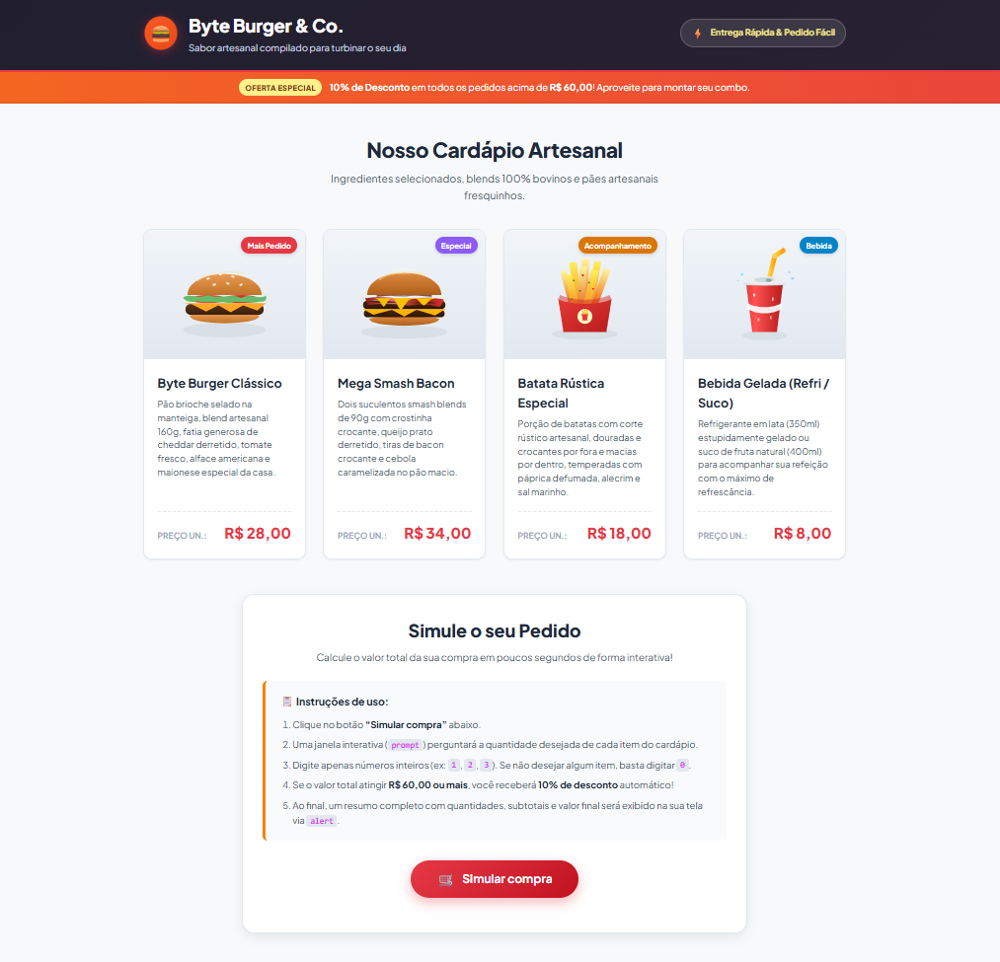

# Byte Burger & Co. - Loja Virtual e Simulador de Compras

> **Projeto:** Desafio 1 - Trilhas Inova Maranhão  
> **Trilha:** Desenvolvimento Mobile  
> **Desenvolvedor:** Gleydson Conceição Silva

---

## 1. Apresentação do Projeto

O **Byte Burger & Co.** é uma aplicação web estática que simula o ambiente de autoatendimento de uma hamburgueria artesanal temática. A aplicação foi concebida com foco em usabilidade, clareza visual e integridade no processamento de pedidos, permitindo a consulta detalhada do cardápio e a simulação de compras com cálculo automático de subtotais, validação de regras de negócio e aplicação de descontos progressivos.

### Cardápio e Tabela de Preços

| Produto | Descrição Técnica do Item | Preço Unitário |
| :--- | :--- | :--- |
| **Byte Burger Clássico** | Pão brioche selado na manteiga, blend artesanal bovino de 160g, queijo cheddar cremoso, fatias de tomate fresco, alface americana e maionese especial da casa. | **R$ 28,00** |
| **Mega Smash Bacon** | Dois smash blends grelhados de 90g com crosta caramelizada, queijo prato derretido, fatias crocantes de bacon premium e cebola caramelizada artesanal. | **R$ 34,00** |
| **Batata Rústica Especial** | Porção individual de batatas rústicas com corte artesanal, fritas sob imersão com casca, temperadas com páprica defumada, alecrim e sal marinho. | **R$ 18,00** |
| **Bebida Gelada (Refri / Suco)** | Bebida individual refrigerada: refrigerante em lata (350ml) ou suco integral de fruta natural (400ml). | **R$ 8,00** |

---

## 2. Tecnologias Utilizadas

A solução foi desenvolvida utilizando exclusivamente padrões web nativos (W3C), sem a inclusão de bibliotecas ou frameworks externos, visando máxima portabilidade e performance:

- **HTML5:** Estruturação semântica do documento através dos elementos `<header>`, `<main>`, `<section>`, `<article>` e `<footer>`, com marcação acessível e metatags de viewport.
- **CSS3:** Folha de estilos padronizada baseada em variáveis customizadas (`:root`), layouts bidimensionais via CSS Grid e unidimensionais via Flexbox, além de transições suaves e design responsivo com media queries.
- **JavaScript (Vanilla JS):** Lógica da aplicação orientada a eventos (`onclick`), captura de entradas via `prompt()`, coerção de tipos com `Number()`, validação numérica defensiva com `isNaN()`, processamento de condicionais e apresentação de resultados via `alert()` e manipulação do DOM.
- **SVG (Scalable Vector Graphics):** Ativos visuais vetoriais independentes e escaláveis, integrados localmente no repositório para assegurar a autonomia e integridade visual da aplicação.

---

## 3. Instruções de Execução

Por tratar-se de uma aplicação cliente puramente estática, não há necessidade de gerenciadores de pacotes ou servidores de aplicação:

1. Clone ou descompacte o repositório no ambiente local.
2. Certifique-se da integridade da árvore de diretórios:
   ```text
   Desafio 1- trilhas/
   ├── .vscode/
   │   ├── extensions.json
   │   └── settings.json
   ├── assets/
   │   ├── batata-rustica.svg
   │   ├── burger-classico.svg
   │   ├── logo.svg
   │   ├── refrigerante.svg
   │   ├── screenshot.png
   │   └── smash-bacon.svg
   ├── .gitignore
   ├── index.html
   ├── README.md
   ├── script.js
   └── style.css
   ```
3. Abra o arquivo `index.html` em qualquer navegador web compatível (Google Chrome, Microsoft Edge, Mozilla Firefox, Safari).
4. Na interface, acione o botão **"Simular compra"** e informe as quantidades solicitadas nas janelas de diálogo sequenciais.

---

## 4. Captura de Tela da Aplicação

Abaixo encontra-se o registro visual da interface desenvolvida:



---

## 5. Casos de Teste e Validações

Com o objetivo de atestar a robustez do fluxo de compra e a conformidade com as especificações exigidas, foram implementados e validados os seguintes cenários:

| Caso de Teste | Dados de Entrada | Comportamento Esperado | Comportamento Observado | Avaliação |
| :--- | :--- | :--- | :--- | :---: |
| **TC-01: Pedido com bonificação de desconto** | 2 Clássicos (R$ 56,00) + 1 Batata (R$ 18,00) = R$ 74,00 | Identificar subtotal >= R$ 60,00 e abater 10% (R$ 7,40). Total final: R$ 66,60. | Desconto de 10% calculado com precisão e discriminado no demonstrativo. | Aprovado |
| **TC-02: Pedido regular sem desconto** | 1 Clássico (R$ 28,00) + 1 Bebida (R$ 8,00) = R$ 36,00 | Processar compra regular (R$ 36,00) e indicar valor restante para elegibilidade de promoção. | Subtotal e total computados sem desconto; mensagem indicando saldo residual exibida. | Aprovado |
| **TC-03: Carrinho vazio (quantidades zeradas)** | Entrada `0` para todos os quatro produtos | Interromper a simulação e alertar o usuário sobre a ausência de itens selecionados. | Notificação *"Nenhum produto foi selecionado"* exibida; fluxo encerrado sem inconsistências. | Aprovado |
| **TC-04: Tratamento de caracteres não numéricos** | Entrada `"texto"` ou valor negativo `"-3"` | Detectar valor inválido (`isNaN` ou `< 0`), alertar o operador e bloquear a execução. | Validação acionada impedindo corrupção nos cálculos matemáticos. | Aprovado |
| **TC-05: Aborto voluntário da operação** | Acionamento da opção "Cancelar" na caixa de diálogo | Detectar retorno `null`, abortar o encadeamento e notificar encerramento. | Operação suspensa de forma limpa, preservando o estado do sistema. | Aprovado |

---

## 6. Desafios de Engenharia e Aprendizados

### Desafios Identificados:
- **Tratamento e coerção de tipos no JavaScript:** O método nativo `prompt()` retorna invariavelmente valores primitivos do tipo `string` (ou `null` em caso de desistência). Foi necessário aplicar conversão explícita através de `Number()`, mitigando erros críticos de concatenação textual durante o cálculo de subtotais e somatórios.
- **Validação defensiva de dados:** A conversão de strings vazias (`""`) ou nulas (`null`) por meio da função `Number()` resulta numericamente em `0`, enquanto cadeias alfanuméricas resultam em `NaN`. Dessa forma, estruturou-se uma camada de sanitização prévia para assegurar que apenas inteiros não negativos avançassem para o cálculo contábil.

### Competências Consolidadas:
- Separação estrita de responsabilidades entre estrutura de conteúdo (HTML), camada de apresentação (CSS) e lógica computacional (JavaScript).
- Estruturação de layouts modernos utilizando CSS Grid para distribuição espacial de cards e Flexbox para alinhamentos internos.
- Construção de fluxos condicionais consistentes para validação de regras de negócio no frontend.

---

## 7. Metodologia e Uso de Ferramentas de Inteligência Artificial

- **Papel da Inteligência Artificial:** A ferramenta atuou de forma consultiva e colaborativa (pair programming), fornecendo propostas de paleta de cores temática para o segmento gastronômico, auxiliando na vetorização matemática das ilustrações em formato SVG local e sugerindo padrões de formatação limpa de código.
- **Adaptações e Refinamentos Realizados:** Todo o código gerado foi minuciosamente adaptado para atender às diretrizes pedagógicas do módulo: vinculação da função pelo atributo `onclick`, utilização sequencial de `prompt()`, coerção estrita com `Number()`, aplicação da regra de desconto progressivo e exibição estruturada por meio de `alert()`.
- **Verificação e Garantia de Qualidade:** Os arquivos foram submetidos a testes manuais em navegador com diferentes combinações de dados e larguras de resolução de tela, garantindo conformidade matemática, integridade sintática e responsividade.
